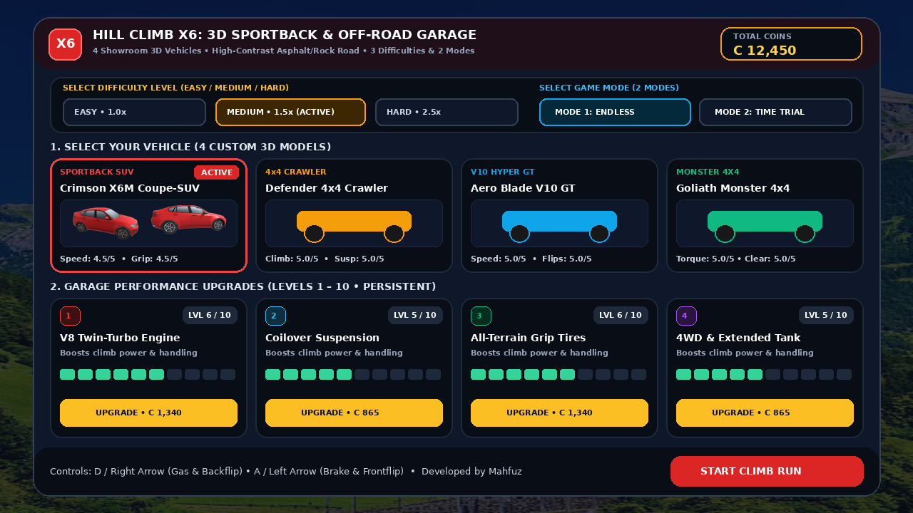
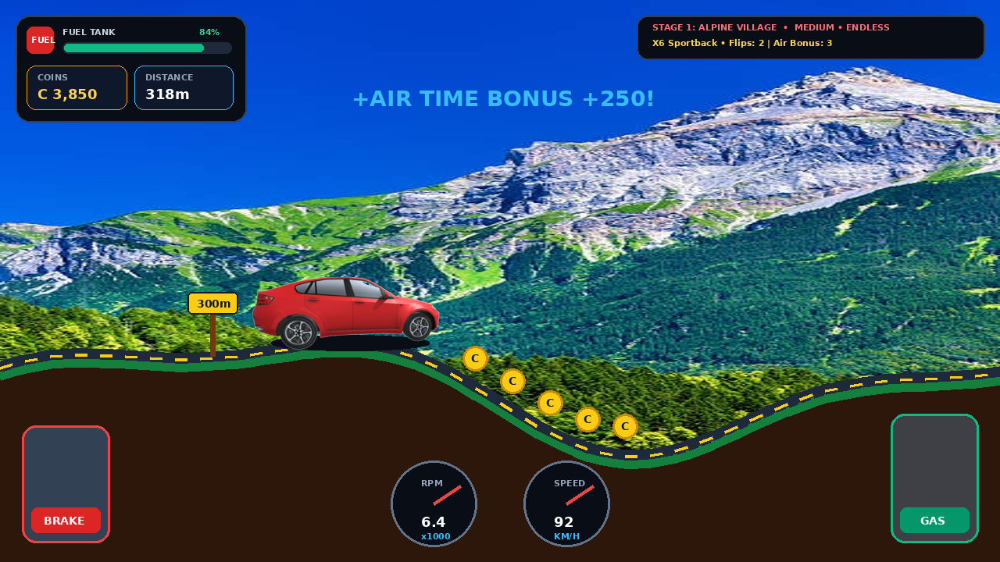
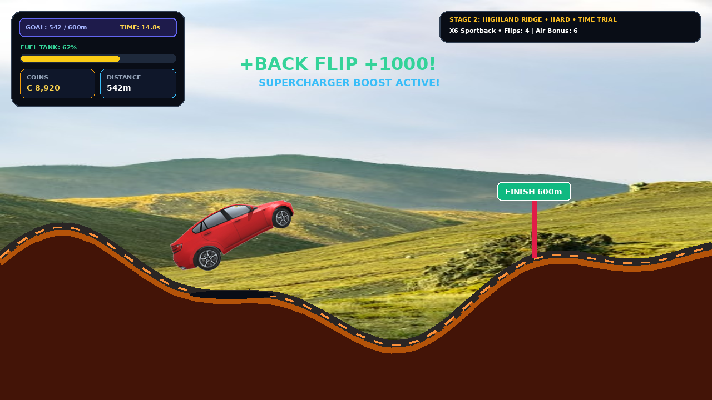

# 🏎️ Hill Climb X6: 3D Sportback & Off-Road Racing

A 2.5D physics-based hill-climbing web game built with **Three.js (WebGL)**, **HTML5 Canvas**, **Tailwind CSS**, and **Web Audio API**, inspired by [Hill Climb Racing on Google Play](https://play.google.com/store/apps/details?id=com.fingersoft.hillclimb&hl=en).

Developed by **[Mustafizur Rahman Mahfuz](https://github.com/mahfuz10-max)** ([itsmahfuz.site](https://itsmahfuz.site/)).

---

## 📸 Screenshots

### 1. Garage, 4 Custom 3D Vehicles, Difficulty & Mode Selector


### 2. Stage 1: Alpine Village Valley — High-Contrast Road & 3D Physics


### 3. Stage 2: Highland Golden Ridge — Time Trial Challenge & Stunt Flips


---

## ✨ Key Features

- **4 Playable 3D Vehicles**:
  1. **Crimson X6M Coupe-SUV** — Showroom gloss red fastback silhouette, recessed coupe glasshouse, 5-spoke dual-tone alloy wheels, red brake calipers, and balanced AWD handling.
  2. **Defender 4x4 Rock Crawler** — Heavy-duty off-road crawler with roof LED bar, roll cage, rear spare tire, and deep suspension travel.
  3. **Aero Blade V10 Supercar** — Low-slung wedge hypercar with GT carbon wing and blistering launch speed for big air stunts.
  4. **Goliath 6.2L Monster Truck** — Lifted tubular chassis and oversized mud-terrain tires for extreme mountain ridges.
- **3 Difficulty Levels (`Easy`, `Medium`, `Hard`)**:
  - Dynamically scales terrain steepness, bump roughness, wheelie sensitivity, fuel consumption, and coin multipliers (`1.0x`, `1.5x`, `2.5x`).
- **2 Game Modes**:
  - **Mode 1: Endless Survival Climb** — Drive as far as possible across procedural mountain ridges without running out of fuel or flipping onto the roof.
  - **Mode 2: Time Trial Challenge** — Beat the target finish distance (`400m` / `600m` / `800m`) before the countdown timer reaches `0s` for massive bonus coins.
- **3 Mountain Biome Stages**:
  - **Stage 1: Alpine Village Valley**
  - **Stage 2: Highland Golden Ridge**
  - **Stage 3: Stormy Green Downs**
- **Persistent 4-Part Garage Upgrades (Levels 1–10)**:
  - Upgrade **V8 Twin-Turbo Engine**, **Coilover Suspension**, **All-Terrain Grip Tires**, and **4WD & Extended Tank** (saved automatically in `localStorage`).

---

## 🎮 Controls

| Action | Keyboard | Touch / Mouse |
| :--- | :--- | :--- |
| **Accelerate / Wheelie / Backflip (Tilt Up)** | `D` or `Right Arrow (→)` | Hold **GAS** Pedal (Bottom-Right) |
| **Brake / Reverse / Frontflip (Tilt Down)** | `A` or `Left Arrow (←)` | Hold **BRAKE** Pedal (Bottom-Left) |

---

## 🚀 Quick Start & Deployment (GitHub Pages / Netlify)

1. Clone or extract this repository:
   ```bash
   git init
   git add .
   git commit -m "Initial release: Hill Climb X6 3D Racing v2.0"
   git branch -M main
   git remote add origin https://github.com/mahfuz10-max/hill-climb-x6-racing.git
   git push -u origin main
   ```
2. **Netlify / GitHub Pages**: Deploy the root directory directly (`index.html` is at the root, with all external images organized in `assets/images/` and `screenshots/`).
